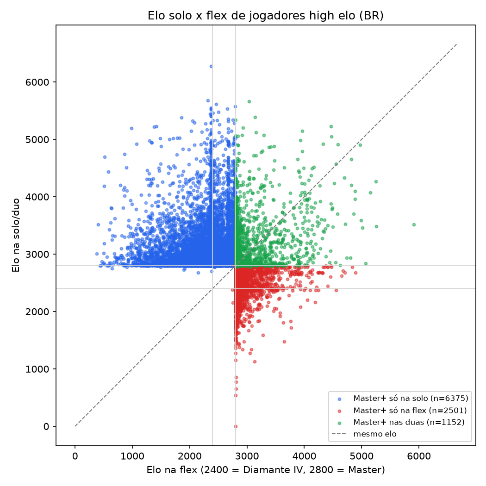

# Teste A: elo cruzado entre filas

Jogadores com elo consultado: 13330

|                                |   jogadores |   sem elo na outra fila |   mediana outra fila |   % Master+ na outra fila |   % abaixo de Diamante |
|:-------------------------------|------------:|------------------------:|---------------------:|--------------------------:|-----------------------:|
| Master+ na FLEX -> elo na solo |        3782 |                     129 |                 2651 |                      32   |                   25.1 |
| Master+ na SOLO -> elo na flex |       10700 |                    3173 |                 2395 |                      15.3 |                   50.4 |

## Queda de elo ao trocar de fila (mín. 20 partidas em cada fila)

- Master+ flex: mediana de queda 353 pts (n=3500)
- Master+ solo: mediana de queda 582 pts (n=5728)
- Diferença das medianas: -229 pts (IC95% bootstrap -254 a -209); 100 pts = 1 divisão
- Mann-Whitney (H1: flex cai mais): U=6540914, p=1

Regressão elo_solo ~ elo_flex (n=8076): inclinação -0.13, intercepto 3334, r=-0.13. Atenção: a amostra é truncada (só high elo), então use como descrição.

